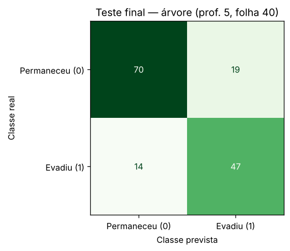
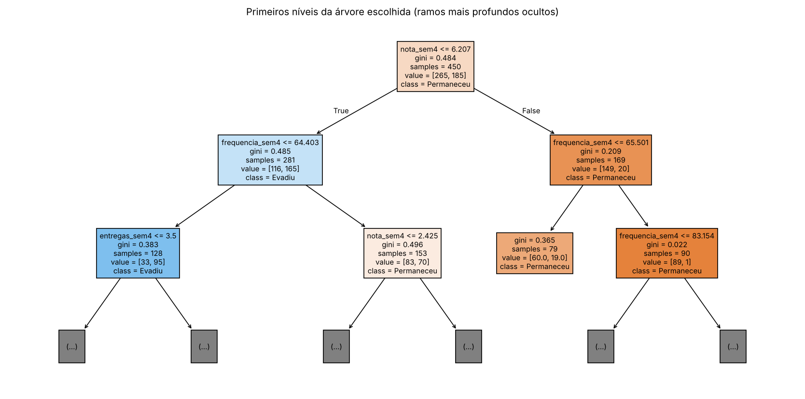
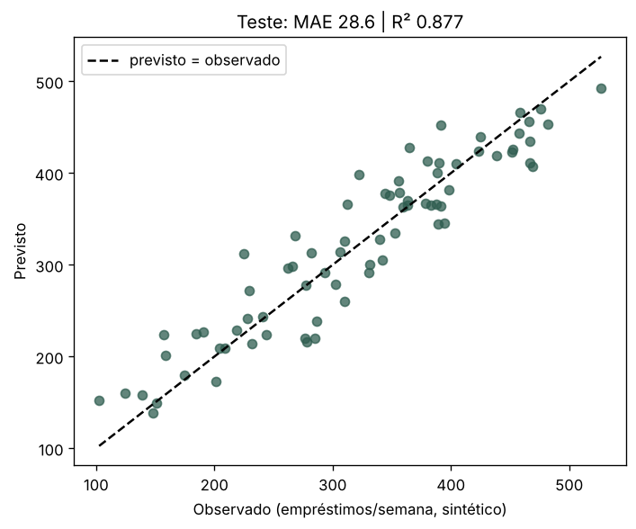
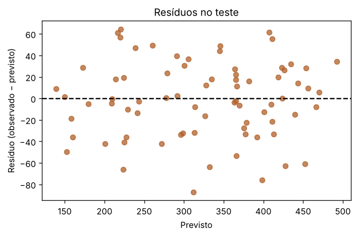

**Profa. Kadidja Valéria | UDF**  
Ciência de Dados e Aprendizado de Máquina · Sistemas de Informação · 2026.2

# Aula 2 — Registro do laboratório supervisionado

## Identificação

- Estudante ou equipe: **Felipe Barbosa Vieira**
- Turma: **SI 7/8 Noturno — Sistemas de Informação**
- Data de realização: **16/10/2026**
- Integrantes e contribuições (se em equipe): **Não se aplica, o trabalho é individual. Executei o notebook, planejei os experimentos e redigi este registro.**

## Percurso escolhido

- [x] Python/Colab ou Jupyter.
- [ ] Orange Data Mining.

Use o [notebook de apoio](notebooks/laboratorio.ipynb) ou o [CSV sintético](dados/educacionais-sinteticos.csv). O CSV contém 600 registros fictícios. Atributos: `frequencia_sem4`, `nota_sem4`, `entregas_sem4`. Alvo: `evasao_fim_semestre` (0 permaneceu, 1 evadiu). As associações foram definidas pela simulação, sem validade empírica sobre estudantes reais.

## 1. Ambiente e reprodução

| Item | Registro |
| --- | --- |
| Ambiente e data | Jupyter (kernel Python 3) em Linux, execução de todas as células em sequência com `nbconvert --execute`. Data da atividade: 16/10/2026. O mesmo notebook abre no Colab pelo botão do [README](README.md). |
| Versões das ferramentas/bibliotecas | Python 3.13.18; NumPy 2.5.3; pandas 3.0.5; matplotlib 3.11.2; scikit-learn 1.9.1 (impressas na primeira célula) |
| Semente aleatória | 42, usada na simulação, em `train_test_split`, em `StratifiedKFold`, `RepeatedStratifiedKFold`, `KFold` e na árvore |
| Caminho do notebook executado ou fluxo Orange | [notebooks/laboratorio-equipe.ipynb](notebooks/laboratorio-equipe.ipynb). Números gravados em [notebooks/resultados_execucao.json](notebooks/resultados_execucao.json). |
| Origem dos dados e condição sintética | Simulação do próprio notebook. Uma célula compara a simulação com [dados/educacionais-sinteticos.csv](dados/educacionais-sinteticos.csv) e devolve `True`. São dados totalmente fictícios. |

## 2. Problema e preparação

- Pergunta de negócio: **Considerando só o que se sabe ao fim da semana 4, que estudantes a equipe de apoio deveria procurar primeiro para oferecer, sem obrigação, monitoria e orientação?**
- Unidade de análise e horizonte: **Cada linha é um estudante fictício. O horizonte vai da semana 4 (momento da previsão) ao fim do semestre (momento em que o alvo é conhecido).**
- Atributos disponíveis no instante da previsão: **`frequencia_sem4` (porcentagem de presença, de 35 a 100), `nota_sem4` (escala 0–10) e `entregas_sem4` (número de atividades entregues, de 0 a 8).**
- Variável-alvo e sua natureza: **`evasao_fim_semestre`, categórica binária. 59,0% permaneceram (classe 0) e 41,0% evadiram (classe 1).**
- Ausências e outros problemas encontrados: **30 valores ausentes (5% das linhas), todos em `nota_sem4`. As outras colunas estão completas e não há identificadores. O alvo foi sorteado a partir de uma probabilidade, então o mesmo perfil pode ter desfechos diferentes, e nenhum modelo chegará a 100%. Na exploração do treino, a evasão cai de 55,0% (0 a 2 entregas) para 29,9% (6 a 8 entregas).**
- Tratamentos e conjunto usado para aprendê-los: **`SimpleImputer(strategy='median')` como primeira etapa do `Pipeline`. A mediana é calculada só com os registros de treino e, na validação cruzada, só com a parte de treino de cada dobra. Não usei padronização, porque a árvore compara cada atributo com um limite e não depende de escala.**

## 3. Desenvolvimento e teste

- Método de divisão e justificativa: **Holdout aleatório estratificado (`test_size=0.25`, `stratify=y`, `random_state=42`). Os estudantes simulados são independentes, então a divisão aleatória é aceitável. A estratificação deixou a evasão em 41,1% no treino e 40,7% no teste. Com dados reais, eu treinaria com semestres passados e testaria no semestre seguinte.**
- Quantidades de treino e teste: **Treino com 450 registros e teste com 150.**
- Procedimento de validação no treino: **Validação cruzada estratificada em 5 partes (`shuffle=True`, `random_state=42`) sobre os 450 registros de treino. Depois do teste, usei também 10 repetições dessa validação (50 ajustes) apenas como experimento.**
- Parâmetros da árvore e como foram escolhidos: **Grade com `max_depth` ∈ {2, 3, 5, None} e `min_samples_leaf` ∈ {5, 10, 20, 40}, feita antes do teste. Regra definida antes de ver os números: entre as configurações a menos de um desvio-padrão da melhor média, escolher a de menor distância treino–validação. Resultado: `max_depth=5`, `min_samples_leaf=40`, com validação de 0,7289 ± 0,0303 e distância de 0,0467. Essa configuração também tinha a maior média.**
- Como o teste ficou fora da seleção: **A grade, a regra de escolha e o ajuste final no treino foram executados antes de qualquer previsão no teste, e o teste foi usado uma única vez. Depois dele, apliquei a configuração do roteiro (prof. 5, folha 10) ao teste só para comparar os tipos de erro, sem trocar o modelo.**

### Alternativa Orange

Confira o alvo como categórico. Registre as conexões: File/Select Columns → Test & Score (Data), Tree → Test & Score (Learner), Test & Score → Confusion Matrix (Evaluation Results). Data Table permite inspeção. Se usar Preprocess, conecte o preprocessor ao learner para ajustar transformações dentro do treino. Não use apenas `Test on train data` como avaliação final.

**Fluxo e método de avaliação realmente utilizados:** Não se aplica, porque usei o percurso Python/Jupyter: holdout estratificado 75/25 e validação cruzada estratificada em 5 partes dentro do treino.

Se comparar configurações, use validação no treino e reserve teste independente. Documente em Test & Score as entradas Data e Test Data, quando utilizadas.

## 4. Resultados calculados de classificação

| Modelo | Configuração | Acurácia de treino | Acurácia de validação e dispersão | Acurácia de teste |
| --- | --- | --- | --- | --- |
| Referência | `DummyClassifier(strategy='most_frequent')`, que prevê sempre "permaneceu" | 0,5889 (média nas dobras) | 0,5889 ± 0,0000 | 0,5933 |
| Árvore final | Mediana + `DecisionTreeClassifier(max_depth=5, min_samples_leaf=40, random_state=42)` | 0,7756 (média nas dobras); 0,7622 no ajuste com os 450 | 0,7289 ± 0,0303 | **0,7800** |

**Matriz: linhas reais e colunas previstas; classe positiva = 1.** ([imagem](assets/matriz-confusao.png))

| Real / previsto | Permaneceu (0) | Evadiu (1) |
| --- | --- | --- |
| Permaneceu (0) | 70 (TN) | 19 (FP) |
| Evadiu (1) | 14 (FN) | 47 (TP) |

- Acurácia calculada manualmente pela matriz: **(TN + TP) / total = (70 + 47) / (70 + 19 + 14 + 47) = 117 / 150 = 0,78.**
- Sensibilidade da classe 1: **TP / (TP + FN) = 47 / (47 + 14) = 47 / 61 ≈ 0,770. A árvore encontra 77% dos estudantes que evadiram no teste. A precisão é de 47 / 66 ≈ 0,712: de cada 10 sinalizados, cerca de 7 de fato evadiram.**
- Comparação com referência: **18,7 pontos percentuais acima da referência (0,780 contra 0,593). Mais importante: a referência não encontra nenhuma evasão (sensibilidade 0), e a árvore encontra 47 de 61. A configuração do roteiro, aplicada depois só para comparação, também chega a 0,78, mas com 19 FN e 14 FP. A mesma acurácia esconde trocas diferentes entre os erros.**
- Consequências dos falsos positivos: **19 estudantes que concluiriam o semestre recebem um contato da equipe de apoio. O custo é tempo da equipe e algum desconforto para quem não precisava. Se o convite for neutro ("a monitoria está aberta"), o custo é baixo.**
- Consequências dos falsos negativos: **14 estudantes que evadiram não são procurados. É o erro mais grave neste uso, porque a pessoa perde a chance de apoio. Por isso a sinalização serve para ordenar contatos e não pode ser a única porta de entrada.**
- Interpretação do gráfico e da árvore: **A raiz pergunta `nota_sem4 ≤ 6,21`. Nos dois ramos a pergunta seguinte é sobre `frequencia_sem4` (limites de 64,4% e 65,5%), e as entregas só aparecem mais abaixo. Importâncias: nota 0,70, frequência 0,21, entregas 0,09. Nesta simulação, nota baixa somada a presença baixa concentra as evasões. Isso reflete a fórmula usada para gerar os dados, não uma explicação do fenômeno. Como as folhas têm pelo menos 40 registros, as estimativas da árvore saem de grupos maiores, e o registro novo (72%, nota 6,0, 5 entregas) recebe 0,227 para a classe 1 e é previsto como "permaneceu" ([árvore](assets/arvore.png)).**

## 5. Experimentos no treino

Compare parâmetros usando apenas treino/validação. Após conhecer o teste, uma nova seleção exige novo teste independente para avaliação final.

| Experimento | Alteração | Resultado de validação | Interpretação |
| --- | --- | --- | --- |
| 1 | Grade `min_samples_leaf` ∈ {5, 10, 20, 40} × `max_depth` ∈ {2, 3, 5, None}, antes do teste | Médias entre 0,6844 (prof. 2, qualquer folha) e 0,7289 (folha 40, prof. 5 ou None). Distância treino–validação de 0,1544 (folha 5, prof. None) a 0,0467 (folha 40). | As médias se sobrepõem: 11 das 16 combinações ficam a menos de um desvio da melhor. O que muda claramente é o sobreajuste, que diminui à medida que a folha cresce. Isso justificou a escolha da folha 40. |
| 2 | Retirar um atributo por vez (prof. 5, folha 40) | Completo: 0,7289. Sem nota: 0,6511 (−0,078). Sem frequência: 0,7311 (+0,002). Sem entregas: 0,7244 (−0,004). | Só a nota faz falta além da variação entre dobras. Frequência e entregas, separadamente, podem ser compensadas pelos outros atributos. |
| 3 (próprio) | Repetir 10 vezes a validação em 5 partes (`RepeatedStratifiedKFold`), depois do teste e só para diagnóstico | Prof. 5/folha 10: 0,7216 ± 0,0352. Prof. 5/folha 40: 0,7144 ± 0,0372. Prof. 2/folha 10: 0,6851. Prof. None/folha 5: 0,7064. A média da folha 40 variou de 0,687 a 0,729 conforme a repetição. | A pequena vantagem da folha 40 na validação única **não se repetiu**: era efeito da divisão em dobras. As duas configurações são equivalentes. Não troquei de modelo porque o teste já tinha sido usado. |
| 4 (próprio) | Curva de aprendizado com 72, 144, 216, 288 e 360 registros de ajuste (prof. 5, folha 40) | Validação: 0,589 → 0,716 → 0,727 → 0,709 → 0,729 | Com 72 registros a árvore não consegue formar folhas de 40 e prevê só a classe majoritária. A partir de cerca de 216 registros a validação estaciona. O teto vem do ruído do alvo, não da falta de dados. |

Responda:

1. Como a profundidade e o tamanho das folhas podem afetar o sobreajuste? **Cada nível a mais e cada folha menor dão à árvore liberdade para criar regras que valem para poucos estudantes, inclusive para o ruído do sorteio. No meu notebook, a árvore sem limite de profundidade e com folha 5 acerta 0,868 no treino e só 0,713 na validação: decorou o treino. Com folha 40, o treino cai para 0,776 e a validação fica em 0,729, uma distância três vezes menor. No extremo oposto, a profundidade 2 erra até no treino (0,733), o que é subajuste. Profundidade e folha regulam a complexidade, e só a validação mostra onde está o equilíbrio.**
2. Retirar um atributo e observar mudança no desempenho prova causalidade? **Não. O experimento mede quanto o modelo perde de capacidade de previsão sem aquele atributo, dado o que os outros já informam. A frequência quase não fez falta, e isso não quer dizer que faltar às aulas não importa: parte da informação dela já está na nota. Para afirmar causa, eu precisaria intervir (por exemplo, mudar a frequência de um grupo e comparar com outro) ou usar métodos causais, o que um ajuste de árvore não faz.**
3. Se 95% permanecem, o que acontece com um modelo que sempre prevê permanência? **Ele parece excelente e não serve para nada. No notebook, com uma turma hipotética de 400 estudantes e 20 evasões, a acurácia é 380 / 400 = 0,95, a matriz fica TN = 380, FP = 0, FN = 20, TP = 0, e a sensibilidade é 0. Nenhum estudante que precisaria de apoio é encontrado. Por isso olho a matriz e a sensibilidade, e não só a acurácia, quando as classes são desbalanceadas.**

## 6. Regressão — seção independente

Execute a seção da biblioteca no notebook ou registre o procedimento equivalente em Orange. Dados também sintéticos. Alvo numérico: empréstimos por semana.

| Item | Registro |
| --- | --- |
| Atributos e alvo | `usuarios_ativos` (de 100 a 1.000) e `horas_abertura` (de 20 a 60 horas por semana). Alvo: `emprestimos_semana`. São 300 semanas simuladas. |
| Divisão e preparação | Holdout aleatório 75/25 (225 semanas no treino e 75 no teste, `random_state=42`) e `Pipeline` com imputação pela mediana (não havia ausentes) + `LinearRegression`. Coeficientes aprendidos: 0,348 empréstimo por usuário ativo e 2,297 por hora de abertura; intercepto de 37,32. |
| MAE do modelo e unidade | **28,59 empréstimos por semana** |
| MAE da referência | **84,73 empréstimos por semana** (`DummyRegressor` com a média do treino; R² de −0,0037 no teste) |
| R² do teste | **0,8774** |
| Interpretação do gráfico observado/previsto | Os pontos acompanham a diagonal do menor ao maior valor, sem formar curva. A relação simulada é linear e o modelo a reproduz ([imagem](assets/regressao-observado-previsto.png)). Nos 5 primeiros registros do teste, os erros vão de 0,4 a 42,3 empréstimos (média de 16,65): algumas semanas são quase exatas, outras erram bastante. |
| Interpretação dos resíduos | Média de −1,28, desvio de 35,47, mínimo de −87,24 e máximo de 64,59. Dividindo o teste em terços pelo valor previsto, o MAE fica em 29,0, 28,0 e 28,7, e o resíduo médio fica perto de zero nos três. O erro não cresce nem muda de sinal ao longo da faixa, o que é compatível com o ruído normal de desvio 35 da simulação ([imagem](assets/regressao-residuos.png)). |
| Limitação de extrapolação | Pedi previsões fora do domínio: 2.000 usuários e 80 h dão 917,1, e 10.000 usuários com 168 h (a semana inteira aberta) dão 3.903,1. O modelo responde sem aviso, mas nunca viu nada parecido, e não sabe de limites físicos (acervo, equipe, espaço). A retirada de atributos por validação no treino mostrou ainda que `usuarios_ativos` sustenta o modelo: sem ele, o MAE vai de 28,9 para 83,7. Sem `horas_abertura`, vai para 35,9. |

Explique por que R² não é porcentagem de acertos: **Em regressão quase nenhuma previsão coincide exatamente com o valor real, então não existe "acerto" a contar. O R² compara a soma dos erros ao quadrado do modelo com a soma que se teria prevendo sempre a média do conjunto avaliado: R² = 1 − SQ_modelo / SQ_média. O valor de 0,877 diz que o erro quadrático do modelo é cerca de 12% do erro dessa previsão ingênua. Não diz que 87,7% das semanas foram acertadas. O R² pode ser negativo quando o modelo é pior que a média.**

## 7. Evidências e conclusão

- Link relativo do notebook/fluxo: **[notebooks/laboratorio-equipe.ipynb](notebooks/laboratorio-equipe.ipynb)** (resultados em [notebooks/resultados_execucao.json](notebooks/resultados_execucao.json))
- Links das imagens, se houver: **[assets/matriz-confusao.png](assets/matriz-confusao.png), [assets/arvore.png](assets/arvore.png), [assets/regressao-observado-previsto.png](assets/regressao-observado-previsto.png), [assets/regressao-residuos.png](assets/regressao-residuos.png)**
- Principal aprendizado: **Fixar a regra de escolha antes de olhar o teste e desconfiar de diferenças pequenas. A minha configuração "vencedora" só ganhava por 0,007, e a validação repetida mostrou que isso era acaso. Duas árvores com a mesma acurácia de teste (0,78) erraram de formas diferentes, e é a matriz que mostra qual troca de erros serve ao objetivo.**
- Limitações de generalização e vieses possíveis: **Os dados são sintéticos e só têm três atributos. Há uma única divisão de 150 registros de teste: um acerto a mais ou a menos move a acurácia em 0,007. Não existem grupos (curso, turno, idade) para verificar se os erros se concentram em alguém. Com dados reais, a divisão teria de ser temporal.**
- Cuidados com privacidade e uso responsável: **O modelo só ordena convites voluntários, sempre revisados por uma pessoa. Uso apenas os atributos necessários, sem nome nem matrícula no conjunto de modelagem. A lista é vista só pela equipe de apoio e apagada ao fim do semestre. Nenhuma consequência acadêmica pode vir da previsão.**

[Voltar ao início](README.md).
