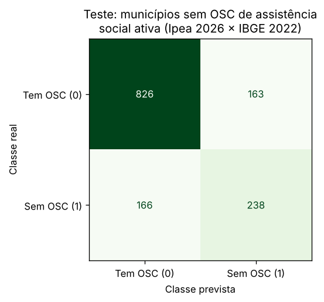

**Profa. Kadidja Valéria | UDF**  
Ciência de Dados e Aprendizado de Máquina · Sistemas de Informação · 2026.2

# Aplicação ao meu TCC — Pescadores Web

## Identificação

- Estudante ou equipe: **Felipe Barbosa Vieira**
- Turma: **SI 7/8 Noturno — Sistemas de Informação**
- Data de realização: **16/10/2026**
- Integrantes e contribuições: **Trabalho individual: formulação, notebook, análise e texto. O TCC Pescadores Web é desenvolvido em dupla com Calebe Mendes Bezerra, que não participou desta atividade.**

## 1. O sistema e o que ele (ainda) não tem

O **Pescadores Web** é o sistema web gratuito (Laravel, FilamentPHP e MySQL) do meu TCC. Ele organiza uma ação social voluntária do Distrito Federal que distribui marmitas, roupas e brinquedos: cadastro de voluntários, doações físicas e monetárias, estoque com alerta de mínimo, agendamento e registro de ações, dashboard para gestores e página pública com estatísticas agregadas ([definição do projeto](../../Unidade_4/Definicao_Projeto_PescadoresWeb_v2.docx)).

Para esta atividade, o ponto central é que **o sistema ainda não tem histórico operacional**: não há registros de doações, saídas de estoque ou ações suficientes para treinar qualquer modelo. As ideias da [seção 5 da atividade 01](01-aula1-conceitos.md) (marmitas por ação, itens em risco de acabar, padrões de participação) continuam como propostas. Não criei dados fictícios para simulá-las: o meu [projeto de ciência de dados](../../Projeto_ciencia_de_dados/README.md) fez a opção explícita de trabalhar só com dados públicos reais, e mantive essa linha aqui.

## 2. Problema escolhido

O projeto de ciência de dados pergunta como os cadastros públicos podem apoiar o **planejamento de parcerias** do Pescadores Web. Ele já fez uma regressão do número de OSCs pela população (R² de teste em log ≈ 0,595), uma classificação da situação cadastral de cada OSC e um agrupamento de municípios. Para não repetir esses trabalhos, mudei a unidade e o alvo:

- **Pergunta de negócio:** só com o porte populacional e a região, é possível reconhecer os municípios onde o cadastro **não oferece nenhuma** OSC de assistência social ativa? Em outras palavras, onde uma busca de parceiros pelo cadastro voltaria vazia?
- **Decisão apoiada (planejamento, não automação):** antes de procurar parceiros em uma localidade, saber se o esperado é encontrar organizações cadastradas ou se será preciso recorrer a outros canais (CRAS, grupos religiosos, coletivos informais). Para qualquer município específico, a consulta direta ao Mapa das OSCs continua sendo a fonte. O modelo serve para entender o padrão e testar se ele é previsível.
- **Unidade de análise:** município (5.570 do Censo 2022).
- **Atributos:** `log10_pop` (log da população em 2022) e região (Norte, Nordeste, Sudeste, Sul, Centro-Oeste, obtida do 1º dígito do código IBGE).
- **Alvo:** `sem_osc_ativa` = 1 se o município tem zero OSCs de assistência social ativas no recorte; 0 caso contrário.
- **Fora dos atributos, por vazamento:** contagem e densidade de OSCs, idade mediana e fração de OSCs recentes, todas calculadas a partir das próprias OSCs.
- **Tipo de tarefa:** classificação supervisionada binária, com o mesmo fluxo da Aula 2.

## 3. Dados

| Item | Registro |
| --- | --- |
| Origem | **Real e pública.** Ipea, *Mapa das OSCs*, arquivo `20260806_MOSC_baseDivulgacao.csv`, filtrado por `Area_Assistencia_social = 1` (58.184 CNPJs), contando apenas os com situação Ativa e não removidos do Mapa (39.836). Cruzamento com a população do IBGE, Censo 2022 (SIDRA, tabela 4714, variável 93). Extração, filtros e hashes SHA-256 em [FONTES.json](../../Projeto_ciencia_de_dados/dados/brutos/FONTES.json). |
| Arquivo usado | [dados/municipios_oscs_assistencia.csv](dados/municipios_oscs_assistencia.csv): cópia de cinco colunas (`cd_municipio`, `municipio`, `uf`, `populacao_2022`, `oscs_ativas`) da tabela [municipios.csv](../../Projeto_ciencia_de_dados/dados/tratados/municipios.csv) do projeto. O notebook tenta, nesta ordem, a cópia local, o arquivo do projeto e os mesmos arquivos no GitHub (para o Colab). |
| Tamanho e classes | 5.570 municípios, dos quais 1.616 (29,0%) sem OSC ativa no recorte |
| Dados pessoais | Nenhum. São contagens por município, e nenhuma OSC é identificada na análise. |
| Registros inventados | Nenhum. Nenhuma linha foi criada, alterada ou imputada. |

## 4. Método

| Item | Registro |
| --- | --- |
| Ambiente | Jupyter, Python 3.13.18, scikit-learn 1.9.1, pandas 3.0.5, NumPy 2.5.3, matplotlib 3.11.2. Semente 42. |
| Notebook | [notebooks/pescadores-web-municipios-sem-osc.ipynb](notebooks/pescadores-web-municipios-sem-osc.ipynb) (executado). Resultados em [notebooks/resultados_pescadores_web.json](notebooks/resultados_pescadores_web.json). |
| Divisão | Holdout estratificado 75/25: 4.177 municípios no treino e 1.393 no teste (29,0% de positivos em ambos) |
| Seleção | `max_depth` ∈ {1, 2, 3, 4, 6, None} × `min_samples_leaf` ∈ {10, 30, 60}, por validação cruzada estratificada em 5 partes no treino. Critério definido antes: **F1 da classe 1**, porque a classe é minoritária e o erro mais prejudicial é o falso negativo (supor que há parceiro cadastrado onde não há). |
| Referências | (a) `DummyClassifier(most_frequent)`, que diz sempre "tem OSC"; (b) **regra programada** "sem OSC se população < L", com L escolhido no treino pelo maior F1 entre 1.000 e 30.000 habitantes. O resultado foi **L = 10.500**. |
| Experimentos no treino | (A) só população × população + região; (B) `GroupKFold` com a UF como grupo, para medir a generalização para estados não vistos. |

## 5. Resultados calculados

**Validação cruzada no treino (configuração escolhida):** profundidade 4, folha 10, com F1 de **0,617 ± 0,023**, acurácia de 0,786 e sensibilidade de 0,595. A referência `Dummy` teve acurácia de 0,710 e F1 de 0. As profundidades 1 e 2 ficaram em F1 de 0,45 e 0,47. A árvore sem limite caiu para 0,547 com folha 10, porque passa a sobreajustar (acurácia de treino 0,831 contra 0,759 na validação).

**Teste final (1.393 municípios, usado uma vez):**

| Modelo | Acurácia | Sensibilidade (classe 1) | Precisão (classe 1) | F1 | TN | FP | FN | TP |
| --- | --- | --- | --- | --- | --- | --- | --- | --- |
| Dummy (sempre "tem OSC") | 0,710 | 0,000 | 0,000 | 0,000 | 989 | 0 | 404 | 0 |
| Regra: população < 10.500 | 0,681 | 0,790 | 0,471 | 0,590 | 630 | 359 | 85 | 319 |
| **Árvore (prof. 4, folha 10)** | **0,764** | 0,589 | 0,594 | **0,591** | 826 | 163 | 166 | 238 |

Pela matriz da árvore: acurácia = (826 + 238) / 1.393 = 0,764; sensibilidade = 238 / 404 = 0,589; precisão = 238 / 401 = 0,594.

**Árvore:** os cortes de população ficam em torno de 7.340 habitantes (raiz), 3.904 e 18.322 habitantes. Importâncias: população 0,713, Nordeste 0,182, Norte 0,078, demais regiões abaixo de 0,02 ([figura](assets/pescadores-web-arvore.png)).

**Erros por porte (teste):**

| Faixa de população | Acertos | Falsos positivos | Falsos negativos |
| --- | --- | --- | --- |
| até 5 mil | 216 | 98 | 40 |
| 5–10 mil | 195 | 44 | 38 |
| 10–20 mil | 270 | 16 | 72 |
| 20–50 mil | 224 | 5 | 15 |
| acima de 50 mil | 159 | 0 | 1 |

Os 163 falsos positivos têm mediana de **1** OSC ativa (média de 1,48, máximo de 8).

**Experimentos no treino:**

| Experimento | Resultado de validação | Leitura |
| --- | --- | --- |
| A — só população | F1 0,484 (sensibilidade 0,380) contra 0,617 com a região | A região acrescenta informação real: no Norte e no Nordeste, municípios do mesmo porte ficam sem OSC com mais frequência. |
| B — `GroupKFold` por UF | F1 0,578 ± 0,100; por dobra, de 0,425 a 0,690 | Quando a validação contém estados que o modelo não viu, o desempenho cai e oscila muito. A validação aleatória comum é otimista para aplicar o modelo a uma UF nova. |

**Distrito Federal:** Brasília (2.817.381 habitantes, 629 OSCs de assistência social ativas no recorte) cai numa folha com 0,4% de casos "sem OSC". No Centro-Oeste como um todo, 32,3% dos municípios não têm OSC ativa no recorte.

## 6. Interpretação

- **Resultado calculado:** a árvore supera a referência trivial (acurácia de 0,764 contra 0,710) e equilibra os dois tipos de erro, mas empata em F1 com uma regra de uma linha baseada só na população (0,591 contra 0,590). A regra encontra mais municípios sem OSC (sensibilidade de 0,79) ao custo de 359 alarmes falsos. A árvore gera menos alarmes falsos (163), mas deixa passar mais casos (166).
- **Interpretação:** para o planejamento de parcerias, **o modelo de ML não se justifica** diante da regra simples. A regra é mais fácil de explicar a gestores voluntários e é a alternativa que eu adotaria. O valor do experimento foi mostrar isso com números, em vez de supor que a árvore seria melhor.
- **Os erros que importam:** quase todos os falsos positivos são municípios pequenos com **uma** OSC ativa. Para quem procura parceiros, esse erro é o mais caro: o modelo diria "não há ninguém" justamente onde existe um possível parceiro. Por isso o resultado nunca substitui a consulta ao cadastro.
- **Para o DF**, onde o Pescadores Web atua hoje, o modelo não acrescenta nada: o cadastro mostra 629 OSCs ativas, e a lista observada (já preparada no projeto) é o que serve para buscar parceiros.
- **Hipótese (não testada):** parte dos "zeros" pode refletir falta de cadastro ou de marcação da área "assistência social", e não ausência de atendimento. Ações informais como a do próprio Pescadores Web não aparecem como OSC. Testar isso exigiria cruzar com outra fonte, por exemplo o Censo SUAS.

## 7. Limites, responsabilidade e próximos passos

- **Associação, não causa:** população e região se associam à presença de OSCs, mas o modelo não explica por que há ou não organizações. As fontes também têm datas diferentes (OSCs em 2026, população em 2022).
- **Zero no cadastro ≠ ausência de assistência social.** Um município sem OSC no recorte pode ter CRAS, igrejas e grupos informais atuando.
- **Dependência espacial:** municípios vizinhos se parecem, e a divisão aleatória não trata isso. O experimento por UF mostra quanto o desempenho pode cair.
- **Uso responsável:** o resultado é um exercício metodológico para planejamento, não um critério para escolher ou descartar parceiros, nem um indicador de carência social de um município.
- **Próximo passo quando o Pescadores Web tiver histórico:** repetir o mesmo fluxo (referência simples primeiro, divisão temporal, matriz de confusão ou MAE) com os registros do próprio sistema, por exemplo para estimar marmitas por ação. O modelo só deve ser adotado se superar a média das ações anteriores e o alerta de estoque mínimo já previsto no TCC.

## Fontes

- IPEA. *Mapa das Organizações da Sociedade Civil* — base de dados. https://mapaosc.ipea.gov.br/base-dados. Arquivo 20260806; extração registrada em [FONTES.json](../../Projeto_ciencia_de_dados/dados/brutos/FONTES.json).
- IBGE. *Censo Demográfico 2022* — população residente, SIDRA tabela 4714, variável 93. https://apisidra.ibge.gov.br/values/t/4714/n6/all/v/93/p/2022.
- VIEIRA, Felipe Barbosa. *Pescadores Web: perfil e distribuição das OSCs de assistência social* — [projeto de ciência de dados](../../Projeto_ciencia_de_dados/README.md) e [resultados](../../Projeto_ciencia_de_dados/resultados/RESULTADOS.md).
- VIEIRA, Felipe Barbosa; BEZERRA, Calebe Mendes. *Definição do projeto Pescadores Web*, versão 2.0. UDF, 2026.
- SCIKIT-LEARN. *User Guide* (Decision Trees; Cross-validation; GroupKFold). https://scikit-learn.org/stable/user_guide.html. Acesso em: 16 out. 2026.

[Voltar ao início](README.md).
