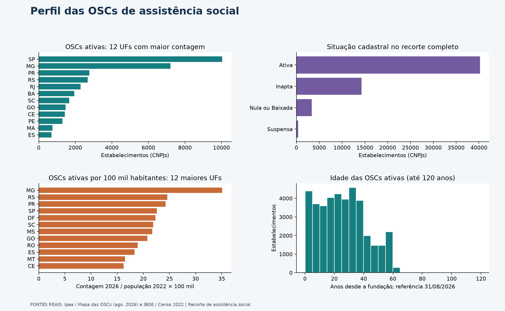
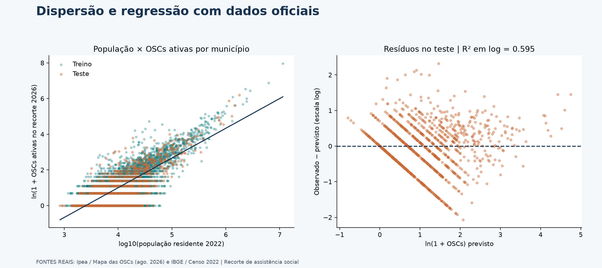
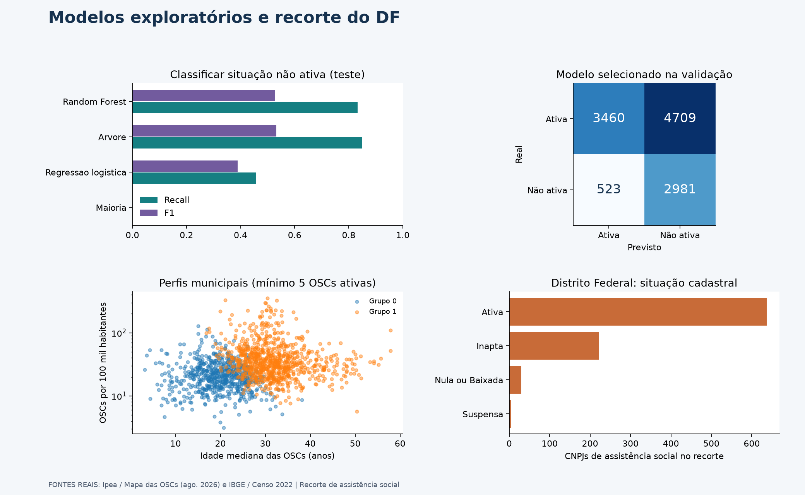

# Pescadores Web: perfil e distribuição das OSCs de assistência social

[](https://colab.research.google.com/github/lipefe11/Ciencia_Dados_Aprendizagem_Maquina/blob/main/Projeto_ciencia_de_dados/notebooks/pescadores_crispdm.ipynb)

**Análise com dados públicos reais do Ipea e do IBGE**, ligada ao TCC Pescadores Web.

> Qual é o perfil e a distribuição das OSCs de assistência social e como os dados
> cadastrais podem apoiar o planejamento de parcerias do Pescadores Web?

Esta versão substitui a demonstração anterior com dados artificiais. Não usa
registros inventados de estoque, doações, voluntários ou atendimentos.

## Fontes reais e rastreabilidade

- **Ipea / Mapa das OSCs:** [base oficial](https://mapaosc.ipea.gov.br/base-dados),
  arquivo `20260806_MOSC_baseDivulgacao.csv`, coleta agosto/2026 conforme o portal.
  Do total de 1.113.949 CNPJs, selecionamos os 58.184 com `Area_Assistencia_social=1`.
- **IBGE / Censo 2022:** população residente dos 5.570 municípios retornados pela
  [API SIDRA, tabela 4714, variável 93](https://apisidra.ibge.gov.br/values/t/4714/n6/all/v/93/p/2022).
- **Contextualização:** [artigo HYB sugerido](https://blog.hyb.com.br/panorama-das-ongs-no-brasil-desafios-e-perspectivas-do-terceiro-setor/)
  e [publicação institucional do IDIS](https://www.idis.org.br/panorama-das-ongs-estudo-revela-resiliencia-do-terceiro-setor-no-brasil/).
  Os artigos não forneceram os registros operacionais ou cadastrais analisados.

Extração: **4 de novembro de 2026**. O recorte e o JSON oficial do IBGE estão em
`dados/brutos/`; URLs, critérios, volumes e hashes SHA-256 estão em
[FONTES.json](dados/brutos/FONTES.json). O CSV integral do Ipea tem 343 MB e não foi
incluído no Git; o script de aquisição permite baixar e repetir o recorte.

## Análises e resultados

| Questão | Técnica | Interpretação |
|---|---|---|
| Onde estão as OSCs de assistência social? | SQL, contagem por UF e município | Estabelecimentos, incluindo filiais |
| Como comparar territórios? | OSCs por 100 mil habitantes | Numerador 2026 / população 2022; não é taxa oficial de 2026 |
| Como população e número de OSCs se relacionam? | Dispersão e regressão linear em log | Associação transversal, sem causalidade |
| Quais perfis municipais aparecem? | K-means padronizado | Exploração de municípios com pelo menos cinco OSCs ativas |
| Como características cadastrais se associam à situação não ativa? | Logística, árvore e Random Forest | Exercício de classificação, sem previsão de fechamento |

- 58.184 CNPJs no recorte; 39.836 com situação Ativa e não removidos do Mapa.
- 894 CNPJs no Distrito Federal, somando as situações cadastrais.
- 3.954 municípios com ao menos uma OSC ativa no recorte.
- Regressão municipal: R² de teste em log de aproximadamente 0,595.
- A árvore foi escolhida pelo F1 na validação; F1 no teste de aproximadamente 0,533.
- Os grupos por raiz de CNPJ impedem que matriz e filiais atravessem treino e teste.

Ver [resultados completos e limitações](resultados/RESULTADOS.md). Situação cadastral
não é saúde financeira, capacidade de atendimento ou necessidade social. Para
consultar uma organização, deve-se usar sua situação observada na fonte, não a
estimativa do modelo. A classificação é um exercício metodológico.

## Gráficos







## Executar

Python 3.12 ou superior. Entre nesta pasta e instale as dependências:

```bash
python -m pip install -r requirements.txt
python scripts/analise.py
python -m unittest discover -s tests -v
python scripts/gerar_relatorios.py
```

O comando de análise lê os arquivos reais já incluídos. Ele não cria registros de
OSCs. Para repetir a aquisição diretamente das fontes oficiais:

```bash
python scripts/obter_dados.py
```

Esse último comando baixa cerca de 344 MB temporários, recorta a fonte e substitui
os arquivos brutos e o manifesto. Uma alteração no arquivo oficial pode modificar
os hashes e resultados. Guarde o manifesto antes de atualizar.

O [notebook CRISP-DM](notebooks/pescadores_crispdm.ipynb) tem saídas executadas. O
botão Colab depende de esta versão ser publicada na branch `main` do repositório.

## Entregas

`dados/brutos`: fontes reais e manifesto. `dados/tratados`: tabelas, qualidade,
métricas e partições. `sql`: oito consultas. `Dashboard`: três painéis.
`notebooks`: seis fases CRISP-DM. `docs`: dicionário, fontes e dois relatórios PDF.
`tests`: procedência, integridade, junções e separação de grupos.

O documento original do TCC, de Felipe Barbosa Vieira e Calebe Mendes Bezerra,
foi preservado. Esta análise contextualiza o planejamento de parcerias e não
afirma que o Pescadores Web já tenha registros operacionais ou integração ao painel.
